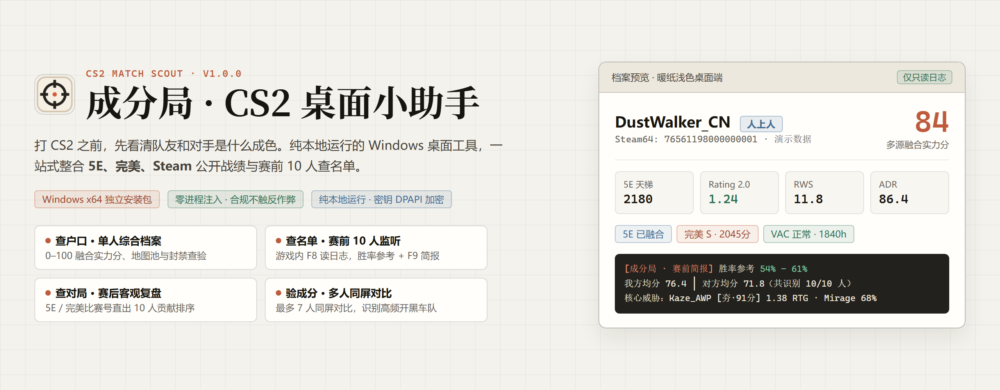
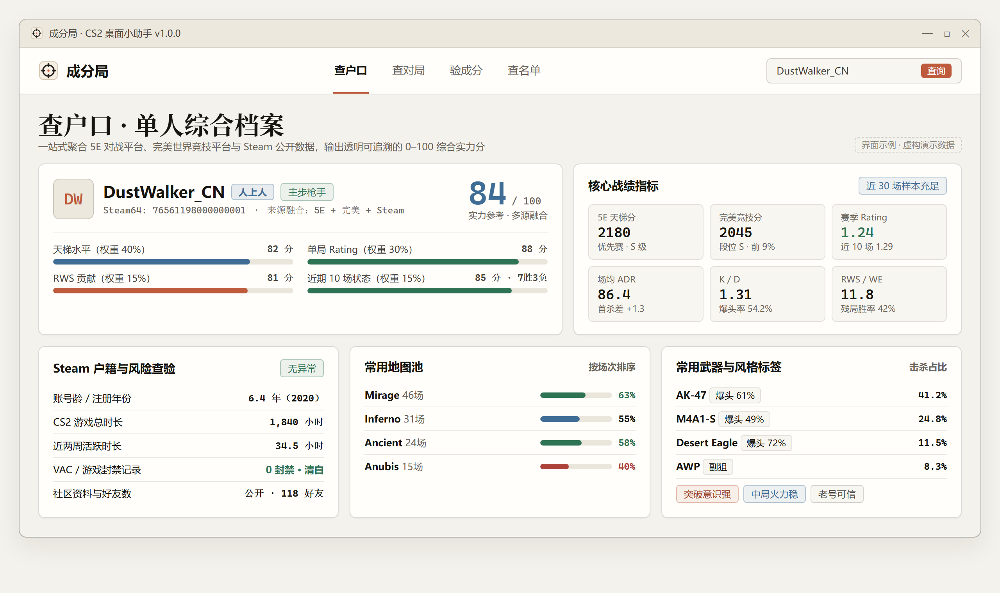
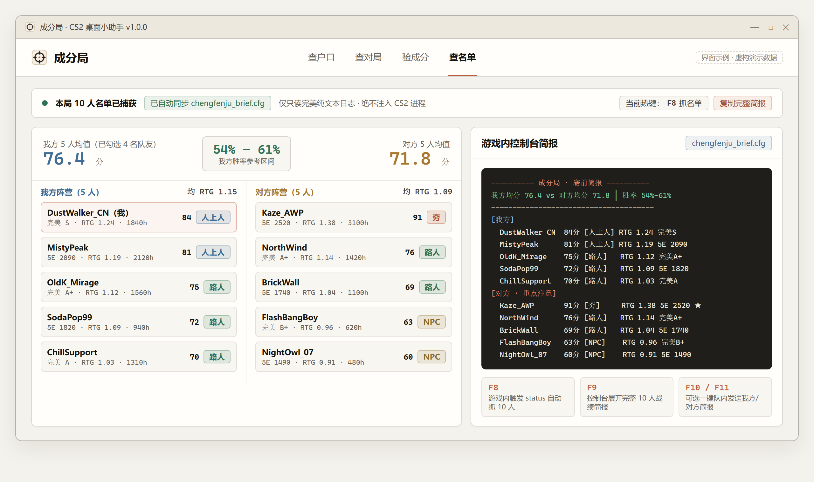
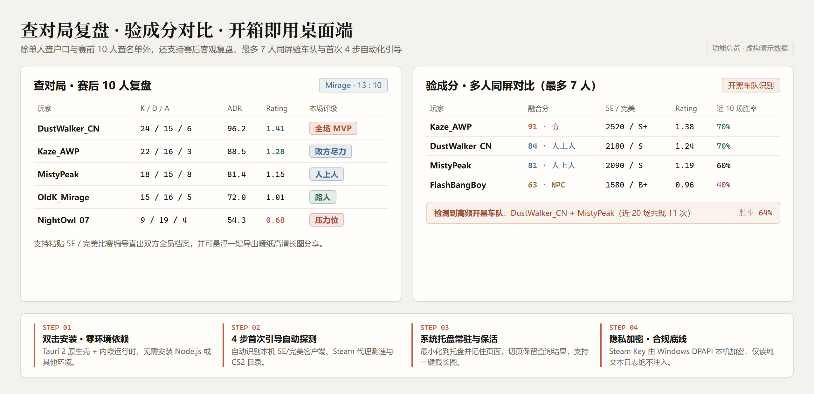

<div align="center">



# 成分局 · CS2 Match Scout

**纯本地运行的 CS2 多平台战绩查询、实力分析与赛前 10 人查名单桌面小助手**

[](https://github.com/HDC327/cs2-match-scout/releases/latest)
[](https://github.com/HDC327/cs2-match-scout/releases/latest)
[](#合规与隐私原则)
[](#合规与隐私原则)

[**⬇️ 前往 Releases 下载最新安装包**](https://github.com/HDC327/cs2-match-scout/releases/latest) · [**📖 功能预览**](#核心功能一览) · [**🚀 安装与上手**](#下载与安装指南) · [**❓ 常见问题**](#常见问题)

</div>

---

> 打 CS2 之前，先看清队友和对手到底是什么成色。  
> 输入昵称、Steam64 或比赛编号，一站式整合 **5E 对战平台、完美世界竞技平台、Steam** 的公开战绩、近期状态、常用图/枪械与风险画像；对局前开启「查名单」，一键读出本局 10 人实力对比与游戏内控制台简报。

> **说明**：本仓库为「成分局 · CS2 桌面小助手」的**官方应用发布与下载仓库**，提供 Windows 安装包、版本更新记录与使用说明，不包含应用源代码。

---

## 合规与隐私原则

- **绝不注入游戏进程，合规不触发反作弊**：不读取/修改 CS2 游戏内存，不注入 DLL，不挂钩系统驱动；「查名单」仅以只读方式读取完美平台生成的纯文本日志（`*.log`），并在用户授权后写入独立简报脚本（`chengfenju_brief.cfg`）。
- **纯本地运行，隐私数据不出本机**：所有查询逻辑、本地缓存与配置均在你的电脑上运行，不向任何第三方服务器上传账号密码、平台登录态或 Steam API Key；Steam API Key 通过 Windows 原生 **DPAPI** 加密保存在 `%APPDATA%\成分局\`。

---

## 核心功能一览

### 1. 查户口 · 单人综合档案

聚合 **5E、完美、Steam** 公开战绩，综合天梯水平、单局 Rating、RWS 与近期 10 场状态，给出透明可查证据来源的 **0–100 综合实力分**与五档评级（`夯` / `人上人` / `路人` / `NPC` / `拉`），同时完整呈现常用地图池、武器倾向与 Steam 号龄/时长/VAC 封禁查验。



### 2. 查名单 · 赛前 10 人监听与控制台简报

进入对局前开启监听，无需频繁切屏即可掌握全场 10 人实力分布：



**默认游戏内热键（可在设置页自定义）：**

| 热键 | 作用 |
| :---: | :--- |
| **`F8`** | 游戏内执行 `status`，桌面端自动捕获本局 10 人名单并拉取战绩 |
| **`F9`** | 在 CS2 控制台展开完整的 10 人实力对比与重点注意简报 |
| **`F10` / `F11`** | 可选开启「同步发送到队内」，分别发送我方 / 对方精简简报 |

### 3. 查对局复盘 · 验成分对比 · 开箱即用桌面端

- **查对局（赛后复盘）**：粘贴 5E 或完美比赛编号，一键拉起 10 人档案与本场贡献排序，并支持悬浮保存暖纸高清长图（自动保存至 `图片\成分局\`）。
- **验成分（多人对比）**：最多支持 **7 人同屏对比**强弱项，自动识别常见开黑车队共现记录。
- **桌面端专属体验**：独立 NSIS 安装包开箱即用，支持首次 4 步自动配置引导、系统托盘最小化记忆页面、多标签切页保活与暖纸浅色沉浸标题栏。



---

## 下载与安装指南

### 系统要求
- **操作系统**：Windows 10 / Windows 11（64 位 `x64`）
- **运行环境**：无需预装 Node.js 或其他依赖，安装包已内置全部运行环境

### 安装步骤

1. 打开 [**Releases 页面**](https://github.com/HDC327/cs2-match-scout/releases/latest)，下载最新版本的 Windows 安装程序：  
   `CS2-Match-Scout_1.0.2_x64-setup.exe`（约 28.5 MB）
2. 双击运行安装程序，阅读免责声明后按向导完成安装（支持仅当前用户安装，无需复杂配置）。
3. 首次打开后，跟随 **4 步引导向导** 即可快速完成：
   - 自动探测本机已安装的 5E / 完美客户端与 CS2 游戏目录；
   - 自动检测并测速 Steam 网络/代理环境；
   - 按需填入 Steam API Key 或一键同步平台登录态，即刻开始使用。

> **关于 Windows SmartScreen 提示**：由于个人独立工具尚未购买商业代码签名证书，首次双击 `.exe` 安装包时 Windows Defender 可能会弹出「Windows 已保护你的电脑」提示。你可以点击 **「更多信息」 → 「仍要运行」** 继续安装，也可以在 PowerShell 中核对下方 SHA-256 校验值确认文件未被篡改：
>
> ```powershell
> Get-FileHash .\CS2-Match-Scout_1.0.2_x64-setup.exe -Algorithm SHA256
> ```
>
> `v1.0.0` 官方 SHA-256：  
> `CB71C00246F9022F16176D052DB2F2C5CD71F6FB78C63255008871B498A8B7D0`

---

## 常见问题

<details>
<summary><strong>使用「查名单」会被 VAC 或 5E / 完美反作弊封禁吗？</strong></summary>

不会。本工具从设计之初就坚持**零游戏进程接触**：不读内存、不注入 DLL、不挂钩任何系统驱动。「查名单」仅被动读取纯文本日志文件和写入标准 CS2 `cfg` 文本脚本（由玩家自行按键触发），与手动在控制台输入 `status` / `exec` 原理完全一致。
</details>

<details>
<summary><strong>我的 Steam API Key 或平台登录态安全吗？</strong></summary>

完全保存在你自己的电脑本地，不会上传至任何第三方服务器。Steam API Key 通过 Windows 原生 DPAPI（绑定当前系统用户）加密存储于 `%APPDATA%\成分局\`，卸载或清理配置后即彻底移除。
</details>

<details>
<summary><strong>为什么 Steam 数据有时拉取较慢？</strong></summary>

国内网络直连 Steam 社区接口偶尔会波动。你可以在应用内「设置」或首次引导中启用自动代理探测与测速，应用会自动选择更顺畅的本地代理通道。
</details>

<details>
<summary><strong>遇到 Bug 或有功能建议怎么反馈？</strong></summary>

欢迎直接在本仓库的 [**Issues**](https://github.com/HDC327/cs2-match-scout/issues) 页面提交问题反馈或建议，也可以通过应用「关于」页面中的公开联系方式联系作者。
</details>

---

## 版本更新记录

### v1.0.2（2026-11-26）
- 修复若干已知问题，大幅优化数据查询加载速度与设置/查对局交互体验

### v1.0.1（2026-11-25）
- 修复若干已知问题并优化桌面端交互细节

### v1.0.0（2026-11-25）
- 正式发布 **成分局 · Windows 桌面小助手**（独立 NSIS 安装包，双击即用）
- 完整上线四大核心模块：**查户口**（单人多源融合档案）、**查对局**（赛后 10 人复盘）、**验成分**（最多 7 人同屏与车队识别）、**查名单**（赛前 10 人日志监听与 `chengfenju_brief.cfg` 控制台简报）
- 新增首次 4 步配置引导、统一设置页、Windows DPAPI 密钥本地加密、系统代理自动探测与测速
- 支持完美登录态前台 UAC 一键同步、5E 自动保活、自定义热键与 CS2 目录选择
- 新增暖纸浅色沉浸界面与 Windows 11 原生标题栏、系统托盘记忆页面、多标签切页保活与本地高清长图保存

---

## 免责声明

- 本工具为非官方个人开发的战绩查询与数据整理工具，与 Valve、Steam、5EPlay、完美世界竞技平台等任何官方机构无隶属或合作关系。
- 综合实力分与胜率区间基于公开战绩数据的统计模型计算，仅供娱乐与赛前/赛后参考，不代表任何玩家的真实竞技水平或官方评级。
- 请合理文明游戏，切勿依据战绩数据对其他玩家进行恶意攻击或消极比赛。
